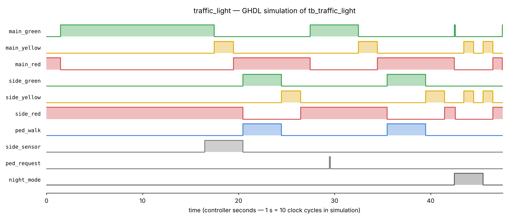
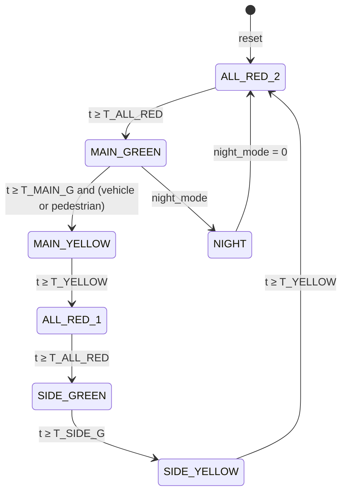

# Traffic Light Controller — VHDL

Digital systems project (Embedded Systems & IoT, **IFRI — Université d'Abomey-Calavi**): modelling, simulation and verification of a traffic-light controller for a two-road intersection, written in **VHDL-2008** and simulated with **ModelSim** or **GHDL**.



## Features

- **Moore finite state machine** with 7 states
- **All-red safety clearance** between every change of direction
- **Vehicle detection on the side road**: the main road keeps the green as long as nobody is waiting
- **Pedestrian button** (latched) served during the side-road phase, when the main road is red
- **Night mode**: blinking yellow on both roads
- Timings in **seconds**, converted with the `CLK_HZ` generic: the same code runs on an FPGA board (50 MHz) and in a fast simulation
- **Self-checking testbench**: safety checked on every clock cycle, plus phase durations

## State machine



| State | Main road | Side road | Pedestrians |
| --- | --- | --- | --- |
| `MAIN_GREEN` | 🟢 | 🔴 | wait |
| `MAIN_YELLOW` | 🟡 | 🔴 | wait |
| `ALL_RED_1` | 🔴 | 🔴 | wait |
| `SIDE_GREEN` | 🔴 | 🟢 | **walk** |
| `SIDE_YELLOW` | 🔴 | 🟡 | wait |
| `ALL_RED_2` | 🔴 | 🔴 | wait |
| `NIGHT` | 🟡 blinking | 🟡 blinking | — |

(Night mode can be entered from any state.)

## Interface

| Port | Dir | Description |
| --- | --- | --- |
| `clk`, `rst` | in | clock, synchronous active-high reset |
| `side_sensor` | in | vehicle waiting on the side road |
| `ped_request` | in | pedestrian button (latched until served) |
| `night_mode` | in | blinking yellow mode |
| `main_red/yellow/green` | out | main road lamps |
| `side_red/yellow/green` | out | side road lamps |
| `ped_walk` | out | pedestrian "walk" signal |
| `state_dbg` | out | current state number (debug / LEDs) |

| Generic | Default | Meaning |
| --- | --- | --- |
| `CLK_HZ` | 50 000 000 | clock frequency |
| `T_MAIN_G` | 20 s | minimum main-road green |
| `T_SIDE_G` | 10 s | side-road green |
| `T_YELLOW` | 3 s | yellow |
| `T_ALL_RED` | 1 s | all-red clearance |

## Verification

The testbench (`tb/tb_traffic_light.vhd`) runs with `CLK_HZ = 10`, so 1 controller second lasts 100 ns. It checks:

1. **Safety, on every clock:**
   - never two greens at once;
   - exactly one lamp per road;
   - pedestrians walk only when the main road is red.
2. The main road stays green when nobody is waiting.
3. A vehicle on the side road is served after yellow and all-red.
4. Yellow, all-red and minimum-green durations match the generics.
5. A pedestrian request is served.
6. Night mode blinks both yellows, then returns to the normal cycle.

```
Test 2 OK: main road stays green without demand
Main yellow duration OK (2 s)
All-red clearance OK
Side yellow duration OK (2 s)
Main green (pedestrian waiting) duration OK (5 s)
Test 3/4 OK: side road served, phase durations correct
Test 5 OK: pedestrian served
Test 6 OK: night mode blinks
ALL TESTS PASSED
```

## Run it

**ModelSim / Questa**

```tcl
cd sim
do run_modelsim.do
```

**GHDL (open source)**

```bash
make sim     # compile + run the testbench
make wave    # also regenerate docs/waveform.png (Python + matplotlib)
```

## Structure

```
src/traffic_light.vhd      controller (FSM + 1 Hz tick)
tb/tb_traffic_light.vhd    self-checking testbench
sim/run_modelsim.do        ModelSim script with the wave window
sim/plot_wave.py           VCD -> PNG timing diagram
docs/waveform.png
Makefile                   GHDL flow
```

---
**Author:** Maël Alain Bradley AZAÏNON — Embedded Systems & IoT, IFRI
